# Práctica N.º 3: Volúmenes para persistir bases de datos con PostgreSQL

## 1. Título

Creación de volúmenes en Docker para guardar datos de PostgreSQL.

## 2. Tiempo de duración

La práctica tuvo una duración aproximada de 120 minutos.

## 3. Fundamentos

Docker es una herramienta que permite trabajar con aplicaciones dentro de contenedores. Estos contenedores funcionan como espacios separados donde podemos ejecutar programas sin tener que instalar todos sus componentes directamente en nuestra computadora. Para crearlos se utilizan imágenes que ya contienen lo necesario para que una aplicación funcione. En esta práctica trabajé con la imagen de PostgreSQL 16.

Una de las ventajas de Docker es que podemos crear, detener y eliminar contenedores fácilmente. Sin embargo, cuando trabajamos con bases de datos, debemos tener cuidado con la información que guardamos. Por ejemplo, si creamos una base de datos dentro de un contenedor y después lo eliminamos, podemos perder el acceso a esa información si no hemos preparado una forma de conservarla.

Para solucionar este problema existen los volúmenes de Docker. Un volumen es un espacio de almacenamiento que permite guardar información de manera independiente al contenedor. Esto significa que podemos eliminar un contenedor y volver a crearlo utilizando el mismo volumen, sin perder los datos que estaban almacenados.

Los volúmenes son muy útiles cuando trabajamos con bases de datos, porque normalmente necesitamos conservar información durante mucho tiempo. Por ejemplo, en un sistema de ventas sería un problema perder los datos de los clientes o los productos cada vez que se elimina un contenedor. Por eso es importante conocer cómo funciona este tipo de almacenamiento.

También utilizamos PostgreSQL, que es un sistema de gestión de bases de datos. Con esta herramienta podemos crear bases de datos, organizar información en tablas y realizar consultas utilizando SQL. Durante la práctica creé una base de datos llamada `test` y una tabla `customer`, donde guardé un registro con un nombre y un estado.

Para trabajar con PostgreSQL utilicé Git Bash y `psql`, que permite ejecutar comandos directamente desde la terminal. También usé pgAdmin4, que facilita la administración de las bases de datos mediante una interfaz gráfica.

La práctica se dividió en dos partes. En la primera trabajé con un contenedor sin configurar un volumen que pudiera reutilizar después. Al eliminarlo y volverlo a crear, comprobé que la base de datos original ya no estaba. En la segunda parte utilicé un volumen llamado `pgdata` y comprobé que la información seguía disponible después de eliminar y volver a crear el contenedor.

Con esta actividad pude entender mejor por qué los volúmenes son importantes y cómo ayudan a conservar la información cuando utilizamos Docker con bases de datos.

**Figura 3-1.** Diferencia entre un contenedor sin almacenamiento reutilizable y otro que utiliza un volumen.

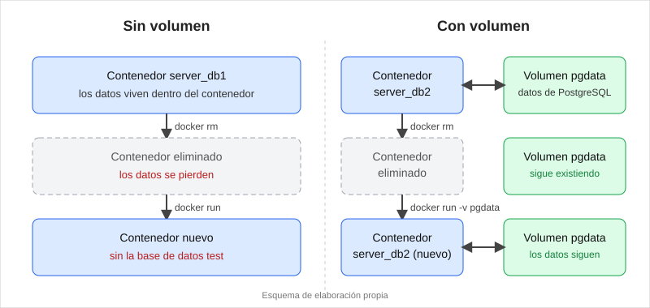

## 4. Conocimientos previos

Para realizar esta práctica fue necesario conocer algunos temas básicos:

- Manejo de Git Bash y comandos de terminal.
- Conceptos básicos de Docker, imágenes y contenedores.
- Comandos para crear, detener y eliminar contenedores.
- Conocimientos básicos de PostgreSQL.
- Uso de pgAdmin4 para consultar bases de datos.
- Comandos SQL para crear bases de datos, tablas e insertar registros.
- Conceptos básicos sobre almacenamiento de información.

## 5. Objetivos a alcanzar

**Objetivo general**

Comprobar cómo funcionan los volúmenes de Docker para conservar la información de una base de datos PostgreSQL después de eliminar y volver a crear un contenedor.

**Objetivos específicos**

- Crear un contenedor PostgreSQL sin configurar un volumen reutilizable y comprobar qué sucede con la información al eliminarlo.
- Crear un volumen en Docker y asociarlo a un contenedor PostgreSQL.
- Crear una base de datos y una tabla para guardar registros.
- Verificar que la información se conserva cuando se vuelve a crear un contenedor utilizando el mismo volumen.

## 6. Equipo necesario

Para realizar esta práctica utilicé:

- Computadora ASUS con Windows 10.
- Git Bash para ejecutar los comandos.
- Docker versión 29.6.1.
- Imagen de PostgreSQL 16.
- pgAdmin4 para administrar las bases de datos.
- Conexión a Internet para descargar la imagen de PostgreSQL.

## 7. Material de apoyo

- Guía de la asignatura sobre volúmenes en contenedores.
- Video explicativo de la profesora sobre la práctica.
- Documentación oficial de Docker.
- Documentación de PostgreSQL.
- Documentación de pgAdmin4.
- Videos proporcionados en el aula virtual:
  - https://www.youtube.com/watch?v=StqsH7Nynvs
  - https://www.youtube.com/watch?v=xKQM3FM-Byk

## 8. Procedimiento

### Parte 1. Base de datos sin volumen reutilizable

### Paso 1. Comprobar el funcionamiento de Docker

Primero abrí Git Bash para revisar que Docker estuviera instalado y funcionando correctamente. Para eso utilicé los siguientes comandos:

```bash
docker --version
docker ps
```

El primer comando mostró que tenía instalada la versión 29.6.1 de Docker. Con el segundo pude revisar los contenedores que estaban funcionando en mi computadora.

**Figura 8-1.** Verificación de Docker y los contenedores en ejecución.

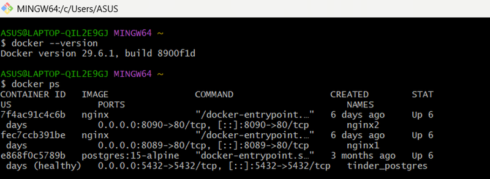

### Paso 2. Crear el contenedor server_db1

Después creé el primer contenedor de PostgreSQL con el nombre `server_db1`.

```bash
docker run --name server_db1 -e POSTGRES_USER=postgres -e POSTGRES_PASSWORD=postgres123 -p 5433:5432 -d postgres:16
```

Utilicé el puerto 5433 porque el puerto 5432 ya estaba ocupado por otro contenedor que tenía en mi computadora.

Luego ejecuté `docker ps` para comprobar que `server_db1` estuviera funcionando.

**Figura 8-2.** Creación del contenedor server_db1.

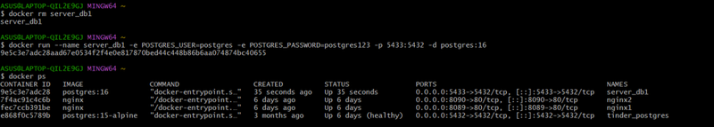

### Paso 3. Crear la base de datos test

Una vez que el contenedor estaba funcionando, ingresé a PostgreSQL desde Git Bash mediante el siguiente comando:

```bash
docker exec -it server_db1 psql -U postgres
```

Después creé la base de datos llamada `test`:

```sql
CREATE DATABASE test;
```

Para comenzar a trabajar dentro de ella utilicé:

```text
\c test
```

### Paso 4. Crear la tabla customer

Dentro de la base de datos `test`, creé una tabla llamada `customer` con los campos `id`, `fullname` y `status`.

```sql
CREATE TABLE customer (
    id SERIAL PRIMARY KEY,
    fullname VARCHAR(100),
    status VARCHAR(50)
);
```

El campo `id` permite identificar cada registro, `fullname` guarda el nombre y `status` permite indicar su estado.

### Paso 5. Insertar un registro

Después agregué un registro a la tabla con el siguiente comando:

```sql
INSERT INTO customer (fullname, status)
VALUES ('Luis Illescas', 'Activo');
```

Para comprobar que se había guardado correctamente, ejecuté:

```sql
SELECT * FROM customer;
```

El resultado mostró el registro que había ingresado.

**Figura 8-3.** Creación de la base de datos, tabla customer e inserción del registro.

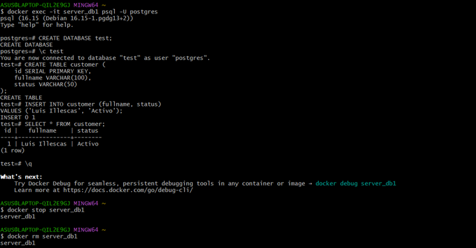

### Paso 6. Detener y eliminar server_db1

Luego de comprobar que el registro estaba guardado, salí de PostgreSQL y detuve el contenedor:

```bash
docker stop server_db1
```

Después lo eliminé:

```bash
docker rm server_db1
```

Estos comandos permitieron detener y eliminar el primer contenedor.

### Paso 7. Volver a crear server_db1

Después volví a crear el contenedor con el mismo nombre y la misma configuración:

```bash
docker run --name server_db1 -e POSTGRES_USER=postgres -e POSTGRES_PASSWORD=postgres123 -p 5433:5432 -d postgres:16
```

**Figura 8-4.** Recreación del contenedor server_db1.

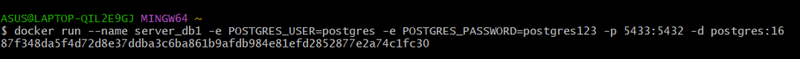

### Paso 8. Comprobar si se conservaron los datos

Volví a ingresar a PostgreSQL mediante:

```bash
docker exec -it server_db1 psql -U postgres
```

Luego ejecuté:

```text
\l
```

Este comando mostró las bases de datos disponibles. En el resultado aparecieron `postgres`, `template0` y `template1`, pero ya no estaba la base `test`.

Con esto comprobé que la información original no se había conservado después de eliminar y volver a crear el contenedor sin reutilizar un volumen.

**Figura 8-5.** Comprobación de que la base de datos test ya no existía.

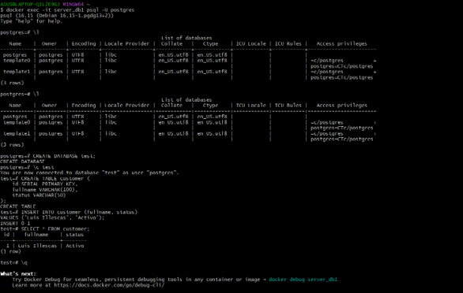

Después de realizar esta comprobación, volví a crear la base de datos, la tabla y el registro. También revisé el contenido desde pgAdmin4.

**Figura 8-6.** Consulta de la tabla customer de server_db1 desde pgAdmin4.

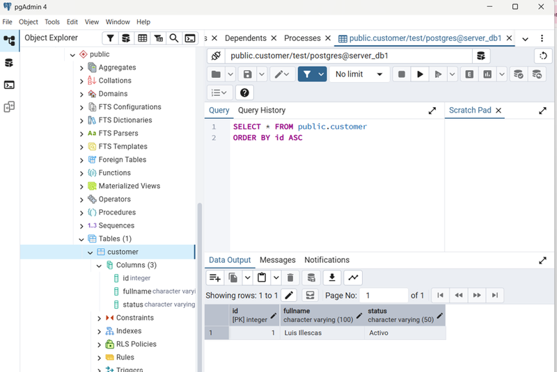

### Parte 2. Base de datos con volumen

### Paso 9. Crear el volumen pgdata

Para comenzar la segunda parte de la práctica, creé un volumen llamado `pgdata` utilizando el siguiente comando:

```bash
docker volume create pgdata
```

Después comprobé que se había creado:

```bash
docker volume ls
```

En la lista de volúmenes apareció `pgdata`, por lo que pude continuar con la práctica.

**Figura 8-7.** Creación y verificación del volumen pgdata.

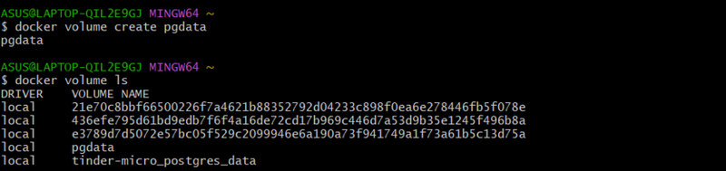

### Paso 10. Crear el contenedor server_db2 con el volumen

Luego creé otro contenedor PostgreSQL llamado `server_db2`, pero esta vez utilizando el volumen `pgdata`.

```bash
docker run --name server_db2 -e POSTGRES_USER=postgres -e POSTGRES_PASSWORD=postgres123 -p 5434:5432 -v pgdata:/var/lib/postgresql/data -d postgres:16
```

En este caso utilicé el puerto 5434 para evitar conflictos con los otros contenedores.

La parte `-v pgdata:/var/lib/postgresql/data` permite conectar el volumen con la carpeta donde PostgreSQL guarda su información.

Después ejecuté `docker ps` para verificar que el contenedor estuviera funcionando.

**Figura 8-8.** Creación del contenedor server_db2 utilizando el volumen pgdata.

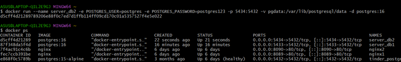

### Paso 11. Conectarse a server_db2 desde pgAdmin4

Abrí pgAdmin4 y registré una conexión para el contenedor `server_db2`.

Utilicé los siguientes datos:

- Nombre: `server_db2`
- Host: `localhost`
- Puerto: `5434`
- Usuario: `postgres`
- Base de mantenimiento: `postgres`

Después de conectarme, pude administrar las bases de datos desde pgAdmin4.

### Paso 12. Crear la base de datos test

Desde pgAdmin4 abrí el Query Tool y ejecuté:

```sql
CREATE DATABASE test;
```

Después ingresé a la base de datos `test` para continuar trabajando.

### Paso 13. Crear la tabla customer

Dentro de la base de datos creé nuevamente la tabla `customer`:

```sql
CREATE TABLE customer (
    id SERIAL PRIMARY KEY,
    fullname VARCHAR(100),
    status VARCHAR(50)
);
```

### Paso 14. Insertar un registro

Luego inserté un registro en la tabla:

```sql
INSERT INTO customer (fullname, status)
VALUES ('Luis Illescas', 'Activo');
```

Para revisar que estuviera guardado, ejecuté:

```sql
SELECT * FROM customer;
```

La consulta mostró el registro ingresado.

### Paso 15. Detener y eliminar server_db2

Después de guardar la información, regresé a Git Bash y detuve el contenedor:

```bash
docker stop server_db2
```

Luego lo eliminé:

```bash
docker rm server_db2
```

En esta parte no eliminé el volumen `pgdata`, porque necesitaba comprobar si la información se conservaba.

### Paso 16. Volver a crear server_db2 con el mismo volumen

Volví a crear el contenedor utilizando el mismo volumen:

```bash
docker run --name server_db2 -e POSTGRES_USER=postgres -e POSTGRES_PASSWORD=postgres123 -p 5434:5432 -v pgdata:/var/lib/postgresql/data -d postgres:16
```

Después ejecuté:

```bash
docker ps
```

El resultado mostró que `server_db2` estaba funcionando nuevamente.

**Figura 8-9.** Verificación del contenedor server_db2 después de volver a crearlo.

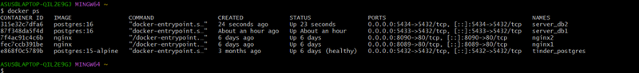

### Paso 17. Comprobar que los datos se conservaron

Finalmente, regresé a pgAdmin4 y abrí la base de datos `test` del contenedor `server_db2`.

Ejecuté la siguiente consulta:

```sql
SELECT * FROM customer;
```

El resultado mostró que el registro seguía guardado, a pesar de que había eliminado y vuelto a crear el contenedor.

Esto fue posible porque la información estaba almacenada en el volumen `pgdata`.

**Figura 8-10.** Comprobación de que los datos se conservaron en server_db2.

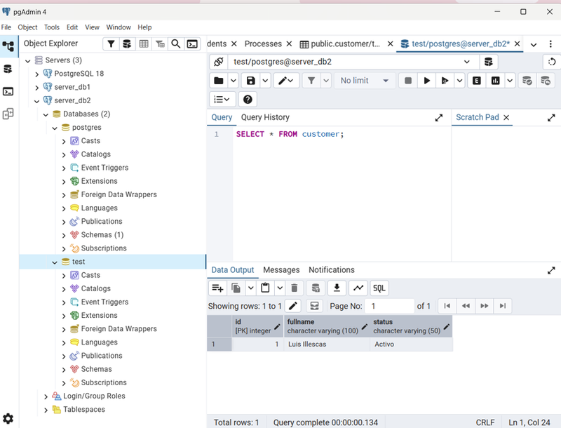

## 9. Resultados esperados

Al finalizar la práctica pude comprobar la diferencia entre trabajar con un contenedor PostgreSQL sin un volumen reutilizable y otro que utiliza un volumen para guardar información.

En la primera parte creé el contenedor `server_db1`, una base de datos llamada `test` y una tabla `customer` con un registro. Después de eliminar y volver a crear el contenedor, comprobé que la base de datos original ya no estaba disponible.

En la segunda parte creé el volumen `pgdata` y lo asocié al contenedor `server_db2`. Después de crear la base de datos y guardar un registro, eliminé el contenedor y lo volví a crear utilizando el mismo volumen. Al revisar nuevamente la tabla desde pgAdmin4, comprobé que el registro seguía guardado.

| Característica | Sin volumen reutilizable | Con volumen |
|---|---|---|
| Contenedor | server_db1 | server_db2 |
| Puerto | 5433 | 5434 |
| Volumen utilizado | No se reutilizó un volumen | pgdata |
| Resultado al recrear el contenedor | La base original desapareció | Los datos se conservaron |

**Figura 9-1.** Resultado de la primera parte: la base de datos original desapareció.


**Figura 9-2.** Resultado de la segunda parte: el registro se conservó.


Con esta práctica aprendí que no basta con crear una base de datos dentro de un contenedor, sino que también debemos pensar en cómo guardar su información. Ahora entiendo mejor para qué sirven los volúmenes y cómo pueden ayudar cuando trabajamos con PostgreSQL en Docker.

## 10. Bibliografía

- Docker Inc. (s. f.). *Volumes*. Docker Docs. https://docs.docker.com/engine/storage/volumes/

- Docker Inc. (s. f.). *Docker volume create*. Docker Docs. https://docs.docker.com/reference/cli/docker/volume/create/

- Docker Hub. (s. f.). *Postgres*. https://hub.docker.com/_/postgres

- PostgreSQL Global Development Group. (s. f.). *PostgreSQL 16 documentation*. https://www.postgresql.org/docs/16/

- pgAdmin Development Team. (s. f.). *pgAdmin 4 documentation*. https://www.pgadmin.org/docs/
